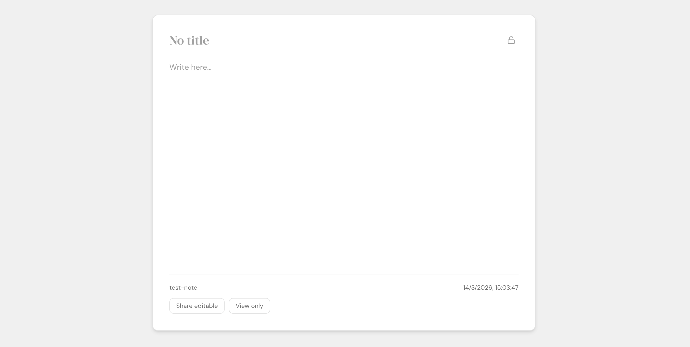

# Slip — Bloc de notas online minimalista (URL primero)

[](https://github.com/martinezpascualdani/slip)
[](https://github.com/martinezpascualdani/slip)
[](https://github.com/martinezpascualdani/slip)
[](https://www.docker.com/)
[](LICENSE)
[](https://fastapi.tiangolo.com/)
[](https://react.dev/)

> **La URL es la nota.**

Slip es un **bloc de notas online** minimalista donde cada nota es una URL.

Abre `/` para crear una nota al instante.  
Abre `/<slug>` para crear o editar esa nota.

Sin cuentas. Sin dashboards. Sin fricción.

Inspirado en pastebins y apps de notas efímeras, Slip elimina la fricción entre abrir un enlace y escribir.



---

## Demo en vivo

*Habrá una demo pública próximamente.*

---

## Por qué Slip

La mayoría de apps de notas empiezan con una cuenta, dashboards y listas de notas.

Slip va al revés:

- La **URL es la nota**
- Sin cuentas
- Sin fricción
- Sin navegación

Si tienes el enlace, tienes la nota.

---

## Características

- **Notas centradas en la URL**  
  Cada nota vive en su propia URL. Sin cuentas, sin dashboards.

- **Guardado automático al instante**  
  El contenido se guarda solo mientras escribes.

- **Enlaces compartibles**  
  Envía un enlace y los demás pueden leer tu nota al momento.

- **Modo solo lectura**  
  Comparte `/v/<slug>` para que no se pueda editar.

- **Protección por contraseña**  
  Protege notas concretas con contraseña.

- **Detección de edición concurrente**  
  Se detectan cambios remotos y puedes recargar si alguien más ha editado la nota.

- **Interfaz bilingüe**  
  Interfaz en inglés y español.

---

## Casos de uso

Slip sirve para:

- compartir notas rápidas
- contenido tipo pastebin temporal
- borradores colaborativos
- enlaces a documentación sencilla

---

## Arranque rápido

Puedes ejecutar Slip en local en menos de un minuto con Docker.

**Requisitos:** Docker y Docker Compose.

```bash
git clone https://github.com/martinezpascualdani/slip.git
cd Slip
cp .env.example .env
docker compose up --build
```

Abre **http://localhost:3000**. Ve a `/` para crear una nota, `/<slug>` para crear o editar, `/v/<slug>` para solo lectura.

---

## Arquitectura

Slip sigue una arquitectura en capas:

```
React SPA
   │
   ▼
Nginx (reverse proxy)
   │
   ▼
FastAPI backend
   │
   ▼
PostgreSQL
```

---

## Stack técnico

| Capa | Stack |
|------|--------|
| **Frontend** | React, TypeScript, Vite, Tailwind CSS |
| **Backend** | Python, FastAPI, SQLAlchemy |
| **Base de datos** | PostgreSQL |
| **Despliegue** | Docker Compose, Nginx (reverse proxy para `/api`) |

---

## API (resumen)

La app sirve la API bajo `/api/` (proxy al backend).

| Método | Endpoint | Descripción |
|--------|----------|-------------|
| `POST` | `/api/notes/random` | Crea una nota con slug aleatorio (201). |
| `GET`  | `/api/notes/{slug}` | Obtiene o crea la nota por slug (200). Envía `X-Note-Password` si está protegida. |
| `PUT`  | `/api/notes/{slug}` | Actualiza título y/o contenido. 403 si está protegida y falta/falla la contraseña. |
| `PUT`  | `/api/notes/{slug}/protection` | Establece o quita la contraseña de la nota. |
| `GET`  | `/api/health` | Health check (sin DB). |

Slugs: `^[a-z0-9-]{3,80}$`, en minúsculas. Slugs reservados (p. ej. `api`, `health`) se rechazan.

---

## Desarrollo

**Backend (local)**

```bash
cd backend
python -m venv .venv && source .venv/bin/activate  # en Windows: .venv\Scripts\activate
pip install -r requirements.txt
cp ../.env.example .env  # configura POSTGRES_HOST=localhost etc.
alembic upgrade head
uvicorn app.main:app --reload
```

**Frontend (local)**

```bash
cd frontend
npm install
npm run dev
```

Vite hace proxy de `/api` a `http://localhost:8000`.

**Migraciones**

- Se aplican solas al arrancar el contenedor del backend.
- A mano: `docker compose exec backend alembic upgrade head`
- Nueva revisión: `docker compose exec backend alembic revision --autogenerate -m "descripción"`

---

## Estructura del proyecto (backend)

| Capa | Función |
|------|---------|
| `core/` | Config, sesión de DB, hash de contraseñas |
| `domain/` | Entidad `Note` (sin ORM) |
| `repositories/` | Interfaz `NoteRepository` |
| `infrastructure/` | Modelo SQLAlchemy e implementación del repositorio |
| `services/` | Generación y validación de slugs |
| `use_cases/` | Crear nota aleatoria, get-or-create, actualizar, protección |
| `api/` | Schemas Pydantic, rutas, health |

---

## Contribuir

Las contribuciones son bienvenidas.  
Abre un issue para comentar ideas o mejoras.

---

## Licencia

MIT © [WHOAMI](https://whoamicorp.com)

---

📄 **[README in English](README.md)**
